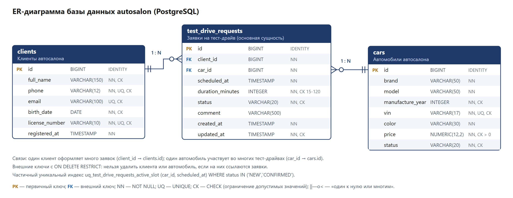
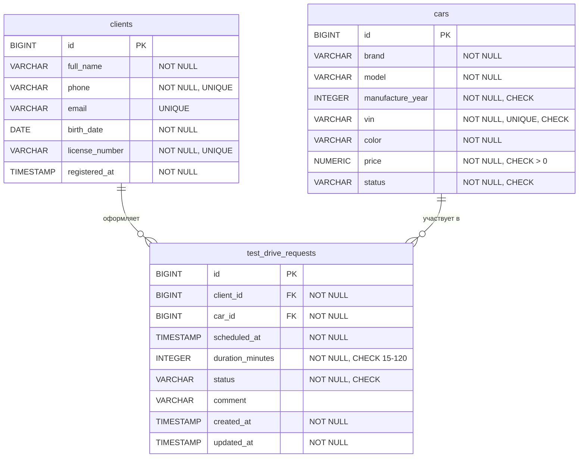

# Автосалон: заявки на тест-драйв (КР 1)

Консольная информационная система автосалона на Java с хранением данных в PostgreSQL.

- **Предметная область:** автосалон.
- **Основная сущность:** заявка на тест-драйв автомобиля (`TestDriveRequest`, таблица `test_drive_requests`).
- **Связанные сущности:** клиент (`Client`, `clients`) и автомобиль (`Car`, `cars`).
- **Архитектура:** `Console UI -> Service -> Repository / JDBC -> PostgreSQL`.

Состав команды: 1. ________ 2. ________ 3. ________ 4. ________

---

## Содержание

1. [Возможности](#возможности)
2. [Технологии](#технологии)
3. [Инструкция по запуску](#инструкция-по-запуску)
4. [Структура проекта](#структура-проекта)
5. [База данных](#база-данных)
6. [Бизнес-правила](#бизнес-правила)
7. [Обработка ошибок](#обработка-ошибок)
8. [Сценарий демонстрации на защите](#сценарий-демонстрации-на-защите)
9. [Пояснения к защите](#пояснения-к-защите)
10. [Модульные тесты](#модульные-тесты)

---

## Возможности

```
====================================================
   АВТОСАЛОН: ЗАЯВКИ НА ТЕСТ-ДРАЙВ АВТОМОБИЛЕЙ
====================================================
1. Клиенты
2. Автомобили
3. Заявки на тест-драйв
4. Поиск заявок
5. Фильтрация заявок
6. Сортировка заявок
7. Статистика
8. Экспорт данных (Excel, CSV)
9. Вывести таблицы базы данных
0. Выход
Выберите действие:
```

| Требование | Реализация |
|---|---|
| CRUD основной сущности | Меню «Заявки на тест-драйв»: показать все, найти по ID, создать, изменить, изменить статус, удалить |
| CRUD участников | Меню «Клиенты» и «Автомобили»: просмотр, поиск по ID, добавление, изменение, удаление |
| Поиск (минимум 2) | 4 способа: по ФИО клиента, по телефону, по марке/модели автомобиля, по дате тест-драйва |
| Фильтрация (минимум 2) | 5 фильтров: по статусу, по клиенту, по автомобилю, по периоду дат, только предстоящие |
| Сортировка (минимум 2) | 6 способов (по возрастанию и по убыванию): дата тест-драйва, дата создания, ФИО клиента, автомобиль, статус, длительность |
| Статистика (минимум 5 показателей) | 19 показателей и распределение заявок по маркам автомобилей |
| Экспорт | Excel `.xlsx` (листы «Заявки на тест-драйв», «Клиенты», «Автомобили», «Статистика») и CSV |
| Вывод таблиц БД | Содержимое таблиц `clients`, `cars`, `test_drive_requests`, а также их столбцы, ключи и ограничения |

## Технологии

- Java 17 (работает и на более новых версиях).
- Maven: сборка, зависимости, исполняемый jar.
- PostgreSQL 14 или новее (проверено на PostgreSQL 18.6).
- JDBC: драйвер `org.postgresql:postgresql` 42.7.13.
- Apache POI 5.5.1: экспорт в Excel.
- JUnit 5: модульные тесты бизнес-правил.

---

## Инструкция по запуску

### 1. Что нужно установить

1. **JDK 17 или новее.** Java 8, которая часто уже стоит в Windows, не подойдёт.
   - Проще всего установить JDK через IntelliJ IDEA (*File → Project Structure → SDK → Download JDK → версия 17, Eclipse Temurin*).
   - Или скачать установщик с <https://adoptium.net>.
   - Проверка в командной строке: `java -version` должна показать 17 или выше.
2. **PostgreSQL** с <https://www.postgresql.org/download/windows/>. При установке:
   - задайте и запомните пароль пользователя `postgres`;
   - оставьте порт `5432`;
   - оставьте компонент pgAdmin, через него удобно выполнять SQL-скрипты.
3. **IntelliJ IDEA Community** (Maven уже встроен) или отдельно Apache Maven 3.9+.

### 2. Создать базу данных

Скрипты лежат в папке `sql/`. Выполните их по порядку.

**Через pgAdmin:**

1. *Servers → PostgreSQL → Databases → postgres* → правой кнопкой → *Query Tool*.
2. Откройте файл `sql/01_create_database.sql` и выполните его (F5): создастся база `autosalon`.
3. Обновите список баз (F5 на *Databases*) и выберите базу `autosalon` → *Query Tool*.
4. Откройте `sql/02_schema_and_data.sql` и выполните его (F5): создадутся таблицы и тестовые данные.
   В результате появится таблица с числом строк: 10 клиентов, 10 автомобилей, 15 заявок.

**Или через psql** (из папки проекта; psql лежит в `C:\Program Files\PostgreSQL\<версия>\bin`):

```bash
psql -U postgres -f sql/01_create_database.sql
```

```bash
psql -U postgres -d autosalon -f sql/02_schema_and_data.sql
```

> Скрипт `02_schema_and_data.sql` можно запускать повторно: он пересоздаёт таблицы и возвращает тестовые данные
> в исходное состояние. Удобно сделать это перед защитой. Даты тест-драйвов отсчитываются от текущего дня,
> поэтому в базе всегда есть и прошедшие, и предстоящие тест-драйвы.

### 3. Указать параметры подключения

Файл `src/main/resources/db.properties`:

```properties
db.url=jdbc:postgresql://localhost:5432/autosalon
db.user=postgres
db.password=postgres
```

Впишите в `db.password` свой пароль пользователя `postgres`. Если запускаете готовый jar, можно не пересобирать
проект: положите свой `db.properties` в папку, из которой запускаете программу. Его значения важнее встроенных.

### 4. Запуск в IntelliJ IDEA

1. *File → Open* → выберите папку `autosalon-testdrive`. IDEA распознает Maven-проект по `pom.xml` и скачает зависимости.
2. Проверьте, что в *File → Project Structure → Project* выбран JDK 17 или новее.
3. Откройте `src/main/java/ru/mirea/autosalon/Main.java` и нажмите зелёную кнопку ▶ рядом с методом `main`.
4. Программа работает во встроенной консоли IDEA, русский текст отображается корректно.

### 5. Запуск из командной строки

```bash
mvn clean package
```

Команда скомпилирует проект, прогонит 22 модульных теста и соберёт `target/autosalon-testdrive.jar` со всеми зависимостями. Запуск:

```bash
java -jar target/autosalon-testdrive.jar
```

В Windows можно просто дважды щёлкнуть `run.bat`. Файлы экспорта сохраняются в папку `export` внутри папки запуска.
Если таблица «Вывести таблицы базы данных» переносится на новые строки, расширьте окно консоли.

### Если что-то не работает

| Сообщение | Что сделать |
|---|---|
| `Ошибка подключения к базе данных: ... сервер PostgreSQL недоступен` | Запустите службу `postgresql-x64-<версия>` (Win+R → `services.msc`) и проверьте порт в `db.url` |
| `... неверное имя пользователя или пароль` | Исправьте `db.user` / `db.password` в `db.properties` |
| `... база данных не найдена` | Выполните `sql/01_create_database.sql` |
| `Ошибка выполнения SQL-запроса: ... таблица не найдена` | Выполните `sql/02_schema_and_data.sql` в базе `autosalon` |
| `UnsupportedClassVersionError` при запуске jar | Запускается старая Java 8: установите JDK 17+ и проверьте `java -version` |

---

## Структура проекта

```
autosalon-testdrive/
├── pom.xml                          Maven: зависимости, сборка исполняемого jar
├── README.md                        эта инструкция
├── run.bat                          запуск собранного jar в Windows
├── sql/
│   ├── 01_create_database.sql       создание базы данных autosalon
│   └── 02_schema_and_data.sql       таблицы, ограничения, индексы, тестовые данные
├── docs/
│   ├── er-diagram.png / .svg        ER-диаграмма базы данных
│   └── autosalon_export_example.xlsx  пример экспорта в Excel
└── src/
    ├── main/java/ru/mirea/autosalon/
    │   ├── Main.java                точка входа: создаёт объекты всех слоёв и запускает меню
    │   ├── model/                   ПРЕДМЕТНАЯ МОДЕЛЬ
    │   │   ├── BaseEntity.java          базовый класс сущностей: id, equals/hashCode, getDisplayName()
    │   │   ├── Client.java              клиент
    │   │   ├── Car.java                 автомобиль
    │   │   ├── TestDriveRequest.java    заявка на тест-драйв (основная сущность)
    │   │   ├── TestDriveStatus.java     enum: статусы заявки и разрешённые переходы
    │   │   ├── CarStatus.java           enum: состояние автомобиля
    │   │   └── TestDriveStatistics.java результат расчёта статистики
    │   ├── repository/              ДОСТУП К ДАННЫМ
    │   │   ├── CrudRepository.java      общий интерфейс CRUD
    │   │   ├── ClientRepository.java, CarRepository.java, TestDriveRequestRepository.java   интерфейсы
    │   │   ├── DatabaseTable.java, TableData.java   вывод таблиц БД «как есть»
    │   │   └── jdbc/                    реализации на JDBC
    │   │       ├── AbstractJdbcRepository.java   общий код JDBC и перевод SQLException
    │   │       ├── JdbcClientRepository.java, JdbcCarRepository.java, JdbcTestDriveRequestRepository.java
    │   │       └── DatabaseTableRepository.java  строки, столбцы и ограничения таблиц
    │   ├── service/                 БИЗНЕС-ЛОГИКА
    │   │   ├── ClientService.java, CarService.java, TestDriveRequestService.java   правила и проверки
    │   │   ├── TestDriveSortOption.java      enum: способы сортировки (Comparator)
    │   │   ├── StatisticsService.java        статистика (Stream API)
    │   │   ├── ExportService.java            сбор данных для экспорта
    │   │   └── DatabaseTableService.java     просмотр таблиц БД
    │   ├── exception/               СОБСТВЕННЫЕ ИСКЛЮЧЕНИЯ
    │   ├── ui/                      КОНСОЛЬНЫЙ ИНТЕРФЕЙС
    │   │   ├── AbstractMenu.java        общий цикл меню и обработка всех ошибок
    │   │   ├── MainMenu.java, ClientMenu.java, CarMenu.java, TestDriveRequestMenu.java,
    │   │   │   SearchMenu.java, FilterMenu.java, SortMenu.java, ExportMenu.java, DatabaseTablesMenu.java
    │   │   ├── ConsoleInput.java        безопасный ввод чисел, дат, ID, выбора из списка
    │   │   ├── ConsoleView.java, TablePrinter.java   вывод таблиц и карточек
    │   │   └── MenuItem.java
    │   └── util/
    │       ├── DatabaseManager.java     подключение к БД по db.properties
    │       ├── DataExporter.java        интерфейс экспорта
    │       ├── ExcelExporter.java, CsvExporter.java, ExportData.java
    │       └── Formats.java             форматы дат, денег, склонение слов
    ├── main/resources/
    │   ├── db.properties            параметры подключения
    │   └── log4j2.xml               настройка логов Apache POI (только ошибки)
    └── test/java/ru/mirea/autosalon/   модульные тесты и репозитории в памяти
```

### Слои приложения

```
Console UI (ui)          читает ввод, показывает меню и результаты, ловит исключения
      │  вызывает методы сервисов
Service (service)        бизнес-правила и проверки, поиск/фильтры/сортировка, статистика
      │  работает через интерфейсы репозиториев
Repository (repository)  SQL-запросы через JDBC: Connection, PreparedStatement, ResultSet
      │
PostgreSQL               хранит данные и обеспечивает ограничения (PK, FK, UNIQUE, CHECK, NOT NULL)
```

В коде меню нет ни одного SQL-запроса: весь SQL находится в пакете `repository.jdbc`.

---

## База данных





| Ограничение | Где используется |
|---|---|
| PRIMARY KEY | `id` во всех таблицах, `GENERATED ALWAYS AS IDENTITY` |
| FOREIGN KEY | `test_drive_requests.client_id -> clients.id`, `test_drive_requests.car_id -> cars.id`, `ON DELETE RESTRICT` |
| NOT NULL | все обязательные поля (необязательны только `email` и `comment`) |
| UNIQUE | `clients.phone`, `clients.email`, `clients.license_number`, `cars.vin` |
| CHECK | формат телефона, email, номера ВУ и VIN; год выпуска; цена > 0; длительность 15–120 мин; допустимые значения статусов; `updated_at >= created_at` |
| Частичный уникальный индекс | `uq_test_drive_requests_active_slot`: у автомобиля не может быть двух активных заявок на одно время |

Тестовые данные: 10 клиентов, 10 автомобилей (в том числе «На обслуживании» и «Продан»),
15 заявок во всех пяти статусах: прошедшие, вчерашняя незакрытая и предстоящие.

---

## Бизнес-правила

Все правила проверяются в сервисах, поэтому они сработают при любом интерфейсе: сейчас это консоль,
в КР 2 будет JavaFX, в КР 3 — REST API. Часть правил дополнительно защищена ограничениями базы данных.

| № | Правило | Где реализовано |
|---|---|---|
| 1 | Нельзя сохранить объект без обязательных полей: ФИО, телефон, дата рождения, номер ВУ клиента; марка, модель, VIN, цвет, цена, статус автомобиля; дата/время тест-драйва | `ClientService.validate`, `CarService.validate`, `TestDriveRequestService.checkSchedule` |
| 2 | Нельзя сохранить некорректные данные: телефон `+7XXXXXXXXXX` (вводить можно и `8 (916) 123-45-67`), email, номер ВУ из 10 цифр, VIN из 17 символов без I/O/Q, год 1990…следующий, цена > 0, комментарий до 500 символов | те же методы + CHECK в БД |
| 3 | Клиенту должно быть не меньше 18 лет | `ClientService.validate` |
| 4 | Телефон, email, номер ВУ клиента и VIN автомобиля уникальны | `ClientService.checkUniqueness`, `CarService.checkVinIsUnique` + UNIQUE |
| 5 | Нельзя указать в заявке несуществующего клиента или автомобиль | `TestDriveRequestService.findClient` / `findCar` + FOREIGN KEY |
| 6 | Записать на тест-драйв можно только автомобиль в статусе «В наличии» | `TestDriveRequestService.checkCarAvailable` |
| 7 | Тест-драйв назначается в будущем, не дальше чем на 60 дней, в часы работы салона 09:00–21:00, длительность 15–120 минут | `TestDriveRequestService.checkSchedule` |
| 8 | Автомобиль не может участвовать в двух активных тест-драйвах одновременно; клиент не может быть записан на два тест-драйва в одно время | `TestDriveRequestService.checkNoTimeConflicts` |
| 9 | У клиента не больше 3 активных (новых и подтверждённых) заявок | `TestDriveRequestService.checkActiveRequestsLimit` |
| 10 | Разрешены только переходы статусов `NEW → CONFIRMED / CANCELLED` и `CONFIRMED → COMPLETED / NO_SHOW / CANCELLED`. «Завершена» и «Неявка» ставятся только после начала тест-драйва, «Подтверждена» — только до начала | `TestDriveStatus.getAllowedTransitions`, `TestDriveRequestService.changeStatus` |
| 11 | Закрытую заявку (завершена, отменена, неявка) нельзя редактировать | `TestDriveRequestService.checkEditable` |
| 12 | Нельзя удалить клиента или автомобиль, по которым есть заявки (история сохраняется). Нельзя продать или отправить на обслуживание автомобиль с активными заявками | `ClientService.delete`, `CarService.delete`, `CarService.checkCanLeaveSale` + `ON DELETE RESTRICT` |

---

## Обработка ошибок

Программа не завершается аварийно. Все исключения перехватывает `AbstractMenu.execute()` и показывает понятное
сообщение, после чего пользователь возвращается в то же меню.

| Ситуация | Что видит пользователь | Как реализовано |
|---|---|---|
| Текст вместо числа | `Ошибка: ID должен быть целым числом.` и повторный запрос | `ConsoleInput.readId`, `readInt`, `readMenuChoice` |
| Неверная дата | `Ошибка: введите существующую дату в формате ДД.ММ.ГГГГ...` | `ConsoleInput.readDate` (`DateTimeFormatter`, режим STRICT) |
| Нет записи с таким ID | `Ошибка: Заявка на тест-драйв с ID 999 не найдена.` | `EntityNotFoundException` |
| Некорректные данные | `Ошибка: некорректные данные. ...` | `ValidationException` |
| Нарушение бизнес-правила | `Нарушение бизнес-правила: ...` | `BusinessException` |
| БД недоступна, неверный пароль, нет базы | `Ошибка подключения к базе данных: ...`, программа продолжает работу | `DatabaseConnectionException` (`DatabaseManager`) |
| Ошибка SQL-запроса | `Ошибка выполнения SQL-запроса: ... [SQLState ...]` | `DataAccessException` (`AbstractJdbcRepository.translateException`) |
| Файл экспорта не записался | `Ошибка экспорта: ...` | `ExportException` |

Иерархия собственных исключений:

```
RuntimeException
└── AutosalonException
    ├── BusinessException
    │   └── ValidationException
    ├── EntityNotFoundException
    ├── DataAccessException
    │   └── DatabaseConnectionException
    ├── ExportException
    └── InputClosedException
```

---

## Сценарий демонстрации на защите

Перед защитой выполните `sql/02_schema_and_data.sql`, чтобы вернуть исходные данные. «Завтра» — следующий день после запуска скрипта.

1. **Структура БД:** `9 → 5`: столбцы, PRIMARY KEY, FOREIGN KEY, UNIQUE, CHECK.
2. **Список и поиск по ID:** `3 → 1`, затем `2`. Введите `abc` (ошибка ввода, программа спросит ID ещё раз),
   затем `999` (запись не найдена). Снова выберите `2` и введите `8`.
3. **Создание заявки:** `3 → 3`, клиент `9`, автомобиль `1` (Toyota Camry), время «завтра 10:30», 30 минут.
   Будет отказ «автомобиль уже занят» (пересечение с заявкой №8). Повторите со временем «завтра 12:00»: заявка создана.
4. **Другие правила:** автомобиль `8` (BMW X5, продан) → недоступен; время `20:30` на 60 минут → вне часов работы;
   вчерашняя дата → «в прошлом»; длительность `200` → некорректные данные.
5. **Статусы:** `3 → 5` для новой заявки: «Завершена» → недопустимый переход; «Подтверждена» → успешно.
   Для заявки `7` (вчерашний тест-драйв): «Завершена» → успешно.
6. **Лимит активных заявок:** создавайте для клиента `1` заявки на разное время, пока не сработает ограничение:
   больше трёх активных заявок у клиента быть не может.
7. **Изменение и удаление:** `3 → 4` (Enter оставляет значение, `-` очищает комментарий), `3 → 6`.
   `1 → 5`: клиента `1` удалить нельзя (есть заявки), клиента `10` можно.
8. **Поиск, фильтры, сортировка:** `4 → 1` (`иван`), `4 → 4` (завтрашняя дата), `5 → 1` (статус «Новая»),
   `5 → 4` (период), `6 → 3` (по ФИО).
9. **Статистика и экспорт:** `7`, затем `8 → 1` и открыть созданный файл из папки `export`.
10. **Ошибка подключения:** остановите службу PostgreSQL (`services.msc`) и выберите любой пункт.
    Появится сообщение об ошибке, программа продолжит работу. Запустите службу обратно.

---

## Пояснения к защите

### Назначение основных классов

| Класс | Назначение |
|---|---|
| `Main` | Создаёт репозитории, сервисы и меню, связывает их и запускает главное меню |
| `Client`, `Car`, `TestDriveRequest` | Сущности предметной области (строки таблиц `clients`, `cars`, `test_drive_requests`) |
| `TestDriveStatus`, `CarStatus` | Перечисления статусов. `TestDriveStatus` знает разрешённые переходы |
| `*Repository` (интерфейсы) и `Jdbc*Repository` | Что умеет хранилище и как это сделано на JDBC |
| `*Service` | Бизнес-правила, проверки, поиск, фильтры, сортировка, статистика, экспорт |
| `AbstractMenu` и `*Menu` | Консольные меню; `AbstractMenu` содержит общий цикл и обработку ошибок |
| `ConsoleInput` / `ConsoleView` | Безопасный ввод данных / вывод таблиц и карточек |
| `DatabaseManager` | Читает `db.properties` и выдаёт подключения `Connection` |
| `ExcelExporter`, `CsvExporter` | Две реализации интерфейса `DataExporter` |

### Инкапсуляция
Все поля классов `private`, доступ к ним идёт через конструкторы, геттеры и сеттеры. Проверки данных спрятаны
в сервисах: меню не может сохранить заявку в обход правил. Объекты-результаты `TestDriveStatistics`, `ExportData`
и `TableData` неизменяемые (`final`-поля, неизменяемые коллекции). `DatabaseManager` скрывает логин, пароль и детали
подключения.

### Интерфейсы
- `CrudRepository<T>` и наследники `ClientRepository`, `CarRepository`, `TestDriveRequestRepository`. Сервисы зависят
  только от интерфейсов. В программе работают JDBC-реализации, а в тестах — реализации в памяти, без базы данных.
- `DataExporter`: общий контракт экспорта для Excel и CSV, с `default`-методом `buildBaseFileName`.
- Функциональные интерфейсы `ParameterSetter` и `RowMapper` в `AbstractJdbcRepository` (передаются лямбдами).

### Enum
- `TestDriveStatus`: статусы заявки с русскими названиями и метод `getAllowedTransitions()` (жизненный цикл).
- `CarStatus`: состояние автомобиля, метод `isAvailableForTestDrive()`.
- `TestDriveSortOption`: каждый способ сортировки хранит свой `Comparator`. Пункты меню сортировки создаются из `values()`.
- `DatabaseTable`: белый список таблиц для вывода.
- В БД статусы хранятся строкой (`status.name()`), а читаются обратно через `TestDriveStatus.valueOf(...)`.

### Полиморфизм
- `ExportMenu` вызывает `exporter.export(...)` у объекта типа `DataExporter`. Что выполнится, зависит от реального
  класса (`ExcelExporter` или `CsvExporter`).
- `BaseEntity.getDisplayName()` абстрактный, и каждая сущность реализует его по-своему.
  `ConsoleView.printShortList(List<? extends BaseEntity>)` одинаково выводит списки клиентов и автомобилей.
- `MainMenu` переопределяет `printHeader()` и `getExitTitle()` базового `AbstractMenu`.
- Сервисы вызывают методы интерфейсов репозиториев, а выполняется код JDBC-реализации.

### Коллекции и Stream API
- `List`: результаты запросов, пункты меню.
- `Map`: `EnumMap` для подсчёта заявок по статусам, `LinkedHashMap` для показателей статистики в нужном порядке,
  `HashMap` для внешних ключей в `DatabaseTableRepository`.
- `Set`: `EnumSet` для разрешённых переходов статусов, `HashSet`.
- `Optional`: результат `findById`.
- Stream API: фильтры (`filter`), сортировка (`sorted` + `Comparator`), статистика (`groupingBy`, `counting`,
  `average`), проверка пересечений тест-драйвов.

### JDBC
Порядок работы смотрите в `AbstractJdbcRepository.queryForList`:
`DriverManager.getConnection(url, user, password)` → `connection.prepareStatement(sql)` → `statement.setLong(1, id)` →
`executeQuery()` / `executeUpdate()` → `while (resultSet.next())` + `getString`, `getLong`, `getObject(..., LocalDateTime.class)` →
автоматическое закрытие ресурсов в `try-with-resources`.
Новые ID получаются через `prepareStatement(sql, new String[]{"id"})` и `getGeneratedKeys()` (см. метод `save`).
`SQLException` переводится в `DataAccessException` с описанием по коду SQLState.

### Statement и PreparedStatement
- `Statement` выполняет готовую строку SQL. Если вставить в неё ввод пользователя, получится SQL-инъекция:
  телефон `' OR '1'='1` превратит запрос `SELECT * FROM clients WHERE phone = '...'` в выборку всех клиентов.
- `PreparedStatement` передаёт SQL с параметрами `?` отдельно от значений. Значения подставляются методами
  `setString` / `setLong` / `setObject` и всегда считаются данными, а не кодом SQL. Заодно драйвер сам преобразует типы
  (`LocalDate` → `DATE`), а запрос можно выполнять повторно.
- В проекте все запросы с данными пользователя используют `PreparedStatement`. Единственная склейка — имя таблицы
  в `DatabaseTableRepository.loadContent`: имена таблиц нельзя передать через `?`, поэтому они берутся только из enum
  `DatabaseTable`. Символы `%` и `_` в строке поиска экранируются (`containsPattern`).

### Связи между таблицами
Связь «один ко многим»: у клиента может быть много заявок (`client_id → clients.id`), автомобиль может
участвовать во многих тест-драйвах (`car_id → cars.id`). `ON DELETE RESTRICT` запрещает удалить клиента или автомобиль,
на которых ссылаются заявки. Заявка читается одним запросом с двумя `JOIN`
(`JdbcTestDriveRequestRepository.SELECT_REQUESTS`) и превращается в объект с вложенными `Client` и `Car`.

### Создание, изменение и удаление записи (на примере заявки)
`TestDriveRequestMenu.create()` читает ID клиента и автомобиля, дату и длительность →
`TestDriveRequestService.create()` проверяет правила 5–9 → `JdbcTestDriveRequestRepository.save()` выполняет
`INSERT ... VALUES (?, ?, ?, ?, ?, ?)` и получает новый ID → заявка перечитывается и выводится.
Изменение (`update`, `changeStatus`) выполняет `UPDATE ... SET ... WHERE id = ?`, удаление — `DELETE ... WHERE id = ?`.

### Поиск, фильтрация, сортировка
- **Поиск** выполняется SQL-запросами с параметрами: `LOWER(c.full_name) LIKE LOWER(?)`, `c.phone LIKE ?`,
  `LOWER(car.brand || ' ' || car.model) LIKE LOWER(?)`, `scheduled_at >= ? AND scheduled_at < ?`.
- **Фильтрация** выполняется в Java через Stream API: `requests.stream().filter(...).sorted(...).toList()`
  (`TestDriveRequestService.filter`).
- **Сортировка** использует `Comparator` из `TestDriveSortOption`; для обратного порядка вызывается `reversed()`.

### Экспорт данных
`ExportService` читает из БД клиентов, автомобили и заявки и считает статистику. Затем вызывает выбранный `DataExporter`:
- `ExcelExporter` (Apache POI): `XSSFWorkbook` → листы → строки → ячейки со стилями. Даты и суммы записываются как
  значения Excel с форматом. Включены автофильтр и закреплённая строка заголовка.
- `CsvExporter`: три файла, кодировка UTF-8 с BOM, разделитель `;` (для русского Excel).

Пример готового файла: `docs/autosalon_export_example.xlsx`.

---

## Модульные тесты

```bash
mvn test
```

22 теста в `src/test/java` проверяют бизнес-правила сервисов без базы данных. Сервисы получают репозитории
в памяти (`repository/memory`) — это ещё один пример того, зачем нужны интерфейсы. Время «сейчас» в тестах
фиксируется через `Clock`.

## Возможное распределение работы в команде

| Участник | Зона ответственности |
|---|---|
| 1 | База данных: SQL-скрипты, ER-диаграмма, JDBC-репозитории (`repository`) |
| 2 | Бизнес-логика: сервисы и бизнес-правила (`service`, `model`) |
| 3 | Консольный интерфейс и обработка ошибок (`ui`, `exception`) |
| 4 | Статистика, экспорт в Excel/CSV, тесты и документация (`util`, `test`, `README.md`) |

Каждый участник должен уметь объяснить весь проект. Удобно пройти «Сценарий демонстрации» вместе
и по очереди рассказать про каждый слой.
